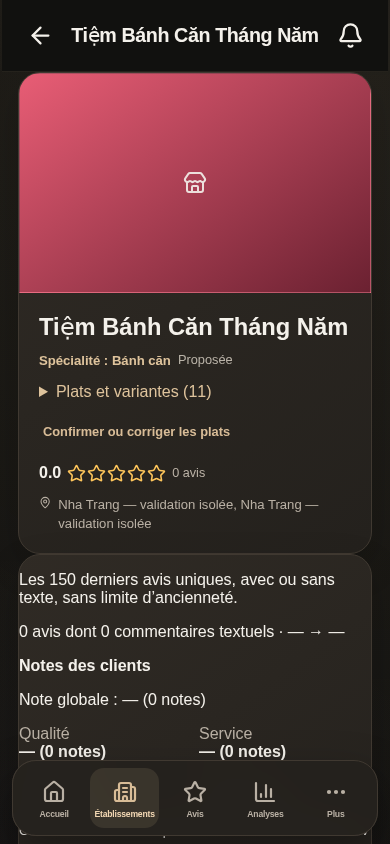
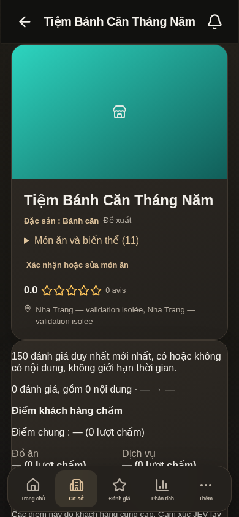
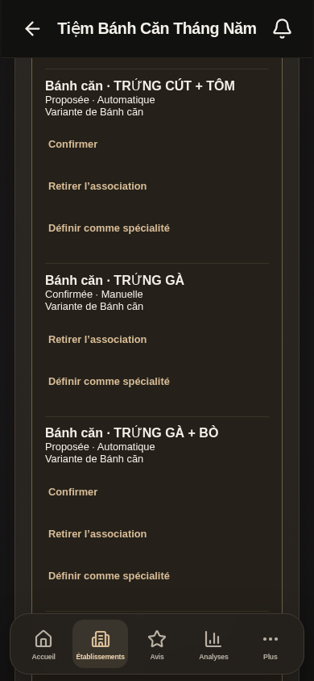
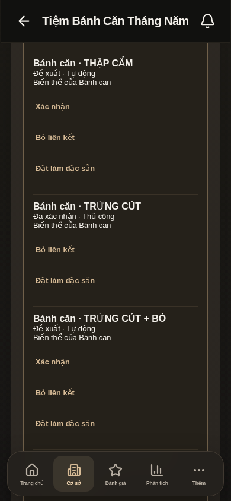
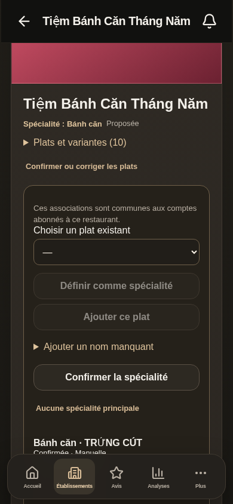
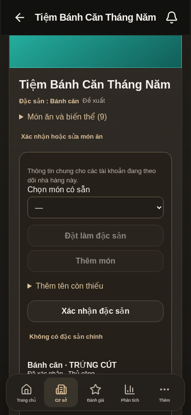
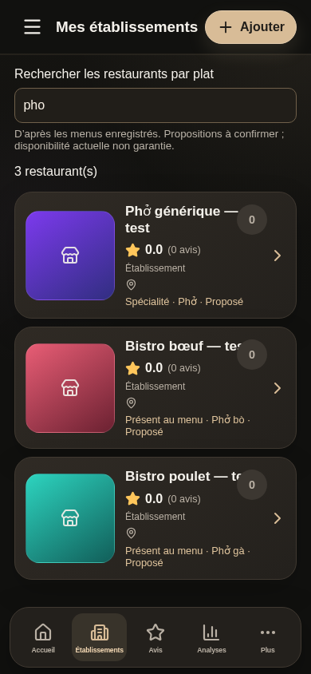
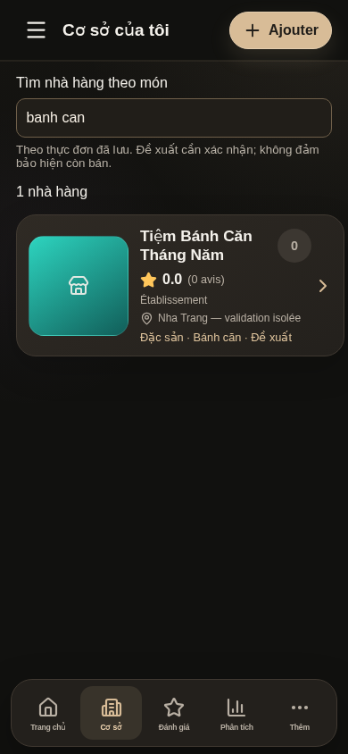

# Validation finale — spécialités et recherche par plat

- Code testé : `8dd5fd4986a2ed10e06c8a501502a692c3cd87c7`.
- [GitHub Actions : run 45378632840 réussi](https://github.com/ngpcao-spec/home-reviews-demo/actions/runs/45378632840).
- Artefact original : `dishes-auth-mobile-evidence`, ID `14912378245`.
- SHA-256 de l'archive téléchargée, identique au digest GitHub : `f9e448e76d8b5a4511207d8068a20879991b9b40624da31cdab08cb79189e4f5`.
- [Reçu original du test](receipt.json), sans identifiant de connexion ni secret.

Les PNG sont les captures de page Playwright originales, sans retouche, réalisées avec le vrai client sur une stack Supabase éphémère. Deux comptes Auth indépendants et deux organisations utilisent la même portée restaurant partagée. Aucune réponse RPC métier n'est simulée dans le navigateur. Le réseau fournisseur est isolé ; zéro appel Apify ou IA, même simulé, est observé. Aucun accès en écriture à la production.

## Captures mobiles 390 × 844

| Parcours | Français | Vietnamien |
|---|---|---|
| Spécialité proposée sous le nom |  |  |
| Confirmation d'une variante |  |  |
| Correction après retrait d'une association |  |  |
| Recherche et résultats |  |  |

Recherche précise : [capture Phở gà — un seul résultat](search-pho-ga-fr.png).

## Résultats constatés

| Contrôle réellement exécuté | Résultat |
|---|---|
| Menu sauvegardé Bánh Căn, run `H8pfAHVslAWq1uno1` | Une spécialité proposée Bánh căn ; 11 associations : 10 variantes et Xíu mại. Aucun intitulé « 11 spécialités ». |
| FR et VI avant toute correction | Même spécialité et mêmes associations ; seuls les libellés d'interface changent. |
| Confirmation par les boutons des deux comptes | TRỨNG GÀ confirmé en FR ; TRỨNG CÚT confirmé en VI ; statuts manuels visibles et partagés. |
| Correction via retrait explicite | THẬP CẨM retiré par FR (10 associations), puis TRỨNG GÀ + BÒ retiré par VI (9). Ces retraits sont des actions de test, pas un jugement sur le menu réel. |
| Retraitement du même menu sous un identifiant de test distinct | 9 associations pour les deux comptes ; confirmations et exclusions manuelles conservées. Raw/result du run source inchangés. |
| Accès aux établissements étrangers | RPC de lecture refusée pour l'établissement de l'autre organisation, partagé ou privé. L'accès au profil commun passe par l'établissement propre au compte. |
| Rôle viewer | Lecture conservée, commande de modification absente, RPC de modification directe refusée. |
| Anonyme et tables privées | RPC anonyme refusée ; aucun droit SELECT direct pour authenticated sur les nouvelles associations ou l'historique des corrections. |
| `pho` | 3 résultats : Phở générique, Phở bò, Phở gà. |
| `phở gà` / `PHỞ GÀ` | 1 résultat : le restaurant avec Phở gà ; aucune attribution au restaurant avec Phở seul. |
| `pho mai` | Aucun résultat, donc pas de correspondance arbitraire par sous-chaîne. |
| Proposition non confirmée | Statut Proposé/Đề xuất et avertissement de disponibilité ; la recherche Bánh căn affiche la spécialité Bánh căn, pas une variante comme spécialité. |
| Largeur mobile | 390 pixels pour le viewport et le document dans les neuf captures ; pas de débordement horizontal. |

Le run valide un parcours navigateur complet (six groupes d'assertions, 18,7 secondes), puis 83 tests ciblés dans cinq fichiers, lint global et build de production. Le workflow échoue si la préparation, le parcours obligatoire ou l'une des neuf captures manque. La stack est supprimée à la fin.

## Corrections effectuées pendant cette validation

1. Les chemins temporaires du runner sont initialisés dans une étape, le contexte `runner.temp` n'étant pas disponible dans le bloc job env.
2. Les fixtures d'établissements incluent l'URL Google Maps imposée par le vrai schéma ; aucune contrainte n'a été retirée pour faire passer le test.
3. La recherche utilise le nom de la spécialité enregistrée pour le badge Spécialité. Le premier examen visuel avait révélé que le nom d'une variante était affiché à cet endroit. Le test SQL a reproduit le défaut avant correction.
4. Les captures de correction sont centrées sur le formulaire pour éviter qu'il soit masqué par l'en-tête fixe.

## Limites et état du déploiement

Chromium en viewport mobile, pas de Safari sur iPhone physique. Auth réelle par mot de passe, pas de nouveau test Google OAuth. Les comptes, les organisations et les restaurants Phở sont des fixtures ; le menu Bánh Căn est une copie sauvegardée d'un résultat réel. La preuve porte sur les fonctions applicatives et la base isolée, pas sur une activation en production. La disponibilité actuelle d'un plat ne peut pas être garantie par le seul menu sauvegardé.

Le code et la migration restent préparés sur `codex/restaurant-dish-associations`. Aucun déploiement, aucun élargissement de la mutualisation, aucune nouvelle extraction ni modification des avis/rapports/synchronisations de production.
